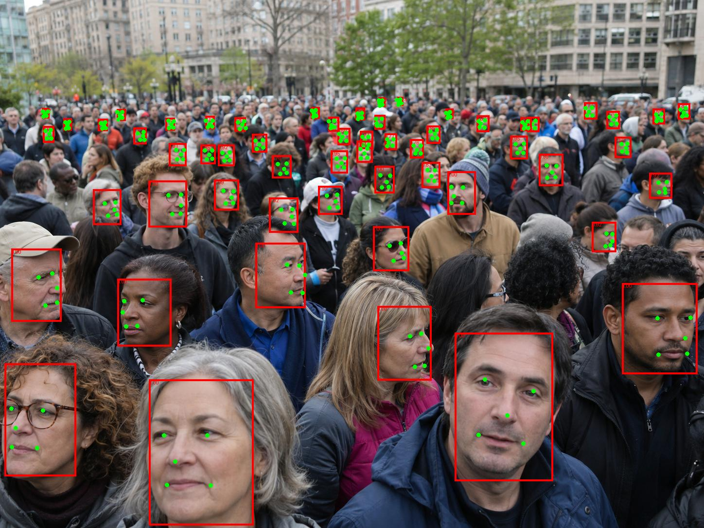

# TernaryCNN RetinaFace

Face detection, rethought with trainable 1.58-bit convolutions.

A compact RetinaFace implementation built around **TernaryCNN** convolutions across its ResNet backbone, feature pyramid, context modules, and prediction heads. It supports face boxes, classification scores, and five-point facial landmarks.

[Explore the features](#features) · [See the measured result](#measured-result) · [Quick start](#quick-start)

## Features

- **Ternary backbones** — ResNet-18 and ResNet-50 options with C3, C4, and C5 feature extraction.
- **Multi-scale perception** — A three-level feature pyramid (FPN) and SSH context blocks.
- **Face and landmark detection** — Box, class, and five-point landmark prediction heads.
- **Training-ready losses** — Prior matching, hard-negative mining, and Smooth L1 losses for boxes and landmarks.
- **WIDER FACE support** — A RetinaFace-style `label.txt` reader with normalized coordinates and missing-landmark handling.
- **Tools for experimentation** — Training CLI, annotated-image inference CLI, Tkinter prediction GUI, unit tests, and a generated-data smoke test.

## Architecture

The model couples a **ternary R18 or R50 backbone** with three-scale feature fusion and SSH context processing. The prediction heads return three tensors, in this order:

| Prediction | Output shape |
| --- | --- |
| Box offsets | `[batch, anchors, 4]` |
| Class logits | `[batch, anchors, 2]` |
| Landmark offsets | `[batch, anchors, 10]` |

The pipeline includes vectorized prior generation, target matching, box and landmark encoding/decoding, and non-maximum suppression (NMS).

## Measured result

A recorded **R18 / 320 px ternary validation** at epoch 54 reported **AP@0.5 = 0.3540** on the 3,226-image WIDER FACE validation split.

- **Backbone:** R18; 320 × 320 input; 64 FPN channels.
- **Validation:** 3,226 images; ternary validation loss 4.9259.
- **Training run:** 12,880 training images and 11,788,640 parameters, as reported in the example log.
- **Checkpoint:** `retinaface-r18-best-ternary.pt` stores frozen ternary weights selected by ternary validation AP@0.5.

This is a **specific training-log snapshot**, not a claim of state-of-the-art accuracy, production reliability, or a general hardware speedup. QAT and frozen ternary models are validated and ranked independently.

## Training profiles

Start small to verify the full training and evaluation path, then scale up when the model and data pipeline are stable.

| Profile | Backbone | Input | FPN channels | Batch size |
| --- | --- | --- | --- | --- |
| Recommended first run | R18 | 320 px | 64 | 8 |
| Higher-capacity run | R50 | 640 px | 256 | 2 |
| Lower-memory run | R18 | 256 px | 32 | 4 |

The source examples target **100 epochs** and use CUDA. Set `--device auto` for a device fallback. Larger images and R50 require more memory and compute; smaller images reduce detail available for small faces.

## Quick start

Run the following commands **inside the TernaryCNN-RetinaFace model repository**, rather than inside this homepage generator:

```bash
uv sync --group dev
uv run pytest
uv run ruff check .
```

Exercise model construction, target matching, loss calculation, backpropagation, checkpoint saving, and ternary conversion **without downloading WIDER FACE**:

```bash
uv run python -m ternarycnn_retinaface.train \
  --smoke-test --save checkpoints/smoke.pt
```

The original development layout uses a local sibling `TernaryCNN` package. For a standalone clone, remove `[tool.uv.sources]` from the model project's `pyproject.toml` to use its configured Git dependency instead.

## Training and checkpoints

With a WIDER FACE dataset under `data/widerface/`, the R18 starter configuration uses `WIDER_train/images`, `WIDER_val/images`, and their corresponding `train/label.txt` and `val/label.txt` files.

A training run can save three distinct artifacts:

- **Latest resumable checkpoint:** `retinaface-r18.pt` — model, optimizer, scheduler, epoch, metrics, and RNG state.
- **Best QAT checkpoint:** `retinaface-r18-best.pt` — weights chosen by QAT validation AP@0.5.
- **Best frozen ternary checkpoint:** `retinaface-r18-best-ternary.pt` — inference-only weights chosen by ternary validation AP@0.5.

Resuming uses `--resume` with the latest checkpoint. The `--epochs` option means the **final epoch target**, not the number of extra epochs. Validation runs over the full WIDER validation split for both QAT and ternary variants, so it can add substantial processing time.

## Inference

Run annotated-image inference from a trained checkpoint:

```bash
uv run python -m ternarycnn_retinaface.infer \
  checkpoints/retinaface-r50.pt photo.jpg \
  --output prediction.jpg --score-threshold 0.5
```

Or launch the desktop GUI to select a checkpoint, choose an image, view boxes, scores, and landmarks, and save the annotated prediction:

```bash
uv run python -m ternarycnn_retinaface.gui
```

The Python API exposes `BitRetinaFace` and `RetinaFaceAnchors` for integration into custom inference or evaluation workflows.

## Training example



The source README associates this prediction example with a **ternary validation AP@0.5 of 0.3540**. The figure uses the original image filename so it can be replaced without changing the Markdown link.

## Current scope

The training pipeline currently resizes images to a square and applies horizontal flipping. The source identifies RetinaFace-style random square cropping and photometric augmentation as useful future extensions for fuller WIDER FACE training.

Training previews are saved by epoch when enabled. The inference CLI and desktop GUI can save annotated prediction images showing boxes, scores, and landmarks.

## Explore the model

This project brings ternary convolutions into an end-to-end RetinaFace training and inference workflow, with reproducible commands and separate QAT/ternary validation. **Start with the smoke test**, then try the R18 / 320 px training profile before scaling up.

[Jump to Quick start](#quick-start) · [Review training profiles](#training-profiles)
